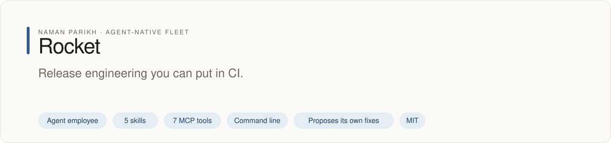
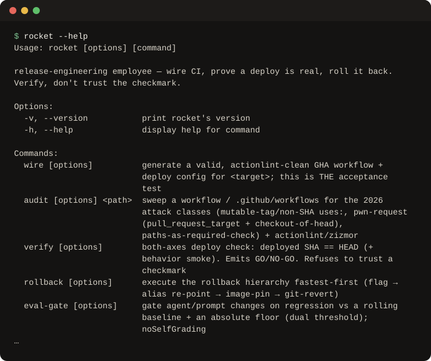

# rocket

<!-- fleet:header:start -->
<p align="center"><picture><source media="(prefers-color-scheme: dark)" srcset="assets/banner-dark.svg"></picture></p>

<p align="center">
<a href="https://github.com/naman10parikh/rocket/actions/workflows/ci.yml"></a>
<a href="https://github.com/naman10parikh/rocket/releases"></a>
<a href="LICENSE"></a>
<a href="#use-it-from-any-coding-agent"></a>
<a href="https://x.com/naman10parikh"></a>
<a href="https://www.linkedin.com/in/naman-parikh1/"></a>
</p>

<p align="center"><a href="#quick-start">Quick start</a> · <a href="https://naman10parikh.github.io/rocket/">Website</a> · <a href="docs/README.md">How it works</a> · <a href="AGENTS.md">AGENTS.md</a> · <a href="llms.txt">llms.txt</a> · <a href="skills/">Skills</a> · <a href="https://github.com/naman10parikh/rocket/discussions">Discussions</a> · <a href="https://github.com/naman10parikh">All projects</a></p>

**Release engineering you can put in CI.**

Rocket is an agent employee, a packaged specialist agent with its own skills, memory and tests. It owns one job: deploy and CI. Coding agents use it through its skills, its MCP server and its command line. A scheduled job runs its evals and proposes fixes. A person makes every change.

_Rocket is part of an agent-native play for agent-native systems that can eventually be recursively self-improving and evolving, operated by agent employees._

<p align="center"></p>
<!-- fleet:header:end -->

rocket is the deploy and CI/CD employee for coding agents: a senior release engineer that gets your code to
production, proves it got there, and keeps rollback possible. It treats a green checkmark as the most dangerous lie
in its field, because a green check binds to a commit, an artifact and a config, and rocket verifies all three.

> Tagline: *"Ships it. Proves it shipped. Rolls it back in seconds."* Powered by Energy.

<!-- fleet:use:start -->
## Use it from any coding agent

**Claude Code**: the plugin brings the skills, sub-agents, hooks and MCP server.

```
/plugin marketplace add naman10parikh/rocket
/plugin install rocket@rocket
```

<details><summary>Its MCP server, Codex, Cursor, Gemini CLI, one skill and the command line</summary>

**Its MCP server**, in any MCP client:

```bash
claude mcp add --transport stdio rocket -- npx -y -p github:naman10parikh/rocket rocket-mcp
codex mcp add rocket -- npx -y -p github:naman10parikh/rocket rocket-mcp
```

Cursor (`.cursor/mcp.json`), Gemini CLI (`.gemini/settings.json`) and most other clients take the same command as JSON:

```json
{
  "mcpServers": {
    "rocket": {
      "command": "npx",
      "args": [
        "-y",
        "-p",
        "github:naman10parikh/rocket",
        "rocket-mcp"
      ]
    }
  }
}
```

**Gemini CLI**: the extension brings the context and the MCP server.

```bash
gemini extensions install https://github.com/naman10parikh/rocket
```

**One skill** (5 in all, in [skills/](skills/)), in any agent that reads Agent Skills:

```bash
gemini skills install https://github.com/naman10parikh/rocket --path skills/deploy-verify
git clone --depth 1 https://github.com/naman10parikh/rocket /tmp/rocket && cp -r /tmp/rocket/skills/deploy-verify ~/.claude/skills/
```

**The command line:**

```bash
npx -y -p github:naman10parikh/rocket rocket --help
```

</details>

Codex, Cursor, OpenCode, GitHub Copilot and other agents read [AGENTS.md](AGENTS.md); Claude Code reads [CLAUDE.md](CLAUDE.md) and Gemini CLI reads [GEMINI.md](GEMINI.md), which import it. [llms.txt](llms.txt) maps every surface for agents that read first.
<!-- fleet:use:end -->

## Quick start

Run it straight from GitHub, with no clone:

```bash
npx -y -p github:naman10parikh/rocket rocket --help
npx -y -p github:naman10parikh/rocket rocket --version
```

From a clone (Node 18 or later; the CLI's build is committed in `tools/rocket/dist/`):

```bash
cd tools/rocket && pnpm install --frozen-lockfile && pnpm build && cd ../..
node tools/rocket/dist/cli.js --version
node tools/rocket/dist/cli.js wire --target ./fixtures/sample-next-app --dry-run
node tools/rocket/dist/cli.js audit --json ./fixtures/bad-workflow.yml
(cd tools/rocket && pnpm test)   # 55 tests
npm run eval                     # golden tasks: 4 at L1 and 6 at L2
```

`wire --dry-run` prints the plan (detect, generate, validate, commit, verify). `audit` reports four findings in the
sample workflow, one of them P0, and says to fix the P0 before any deploy. A local cockpit shows the brain, the run log,
the eval scores and an ask-the-employee box: `bash scripts/serve.sh`, then open http://localhost:7799.

## How it works

Point rocket at a repository and it wires a lint-clean GitHub Actions pipeline, a reachable deploy and a preview on
the second commit (`rocket wire`). Ask it to prove a deploy is real and it checks both axes: the right artifact is
live, and the live artifact behaves. It answers GO or NO-GO with the gauges that proved it. Its moat is that
verify-don't-trust discipline and eval-gated CI (block on regression, not an absolute floor), more than the
workflow generator.

| Command | MCP tool | What it does |
| --- | --- | --- |
| `rocket wire --target <repo> [--lane vercel] [--dry-run]` | `rocket_wire` | Generates an actionlint-clean workflow and Vercel deploy config, and names the two files for you to commit. The Fly, Cloudflare and Railway lanes are planned. This is the acceptance test. |
| `rocket audit <workflows dir or repo>` | `rocket_audit` | Sweeps the supply-chain attack classes with actionlint and zizmor; P0 and P1 findings with SHA-pin fixes. |
| `rocket verify --target <repo\|url> [--sha <expected>]` | `rocket_verify` | The both-axes check: deployed SHA equals HEAD, and a behaviour smoke test passes. Answers GO or NO-GO. |
| `rocket rollback --target <repo> [--to <deployment\|image>]` | `rocket_rollback` | The rollback hierarchy, fastest first: flag, alias repoint, image pin, git revert. |
| `rocket eval-gate --baseline <ref> [--floor <n>]` | `rocket_eval_gate` | Gates a release on regression against a rolling baseline plus an absolute floor. |
| `rocket migrate-plan --diff <schema-diff>` | `rocket_migrate_plan` | The expand-contract three-phase plan; refuses a destructive change coupled with dependent code. Plan only. |
| `rocket preview reap --repo <repo> [--older-than <d>]` | `rocket_preview_reap` | Lists, then tears down, leaked preview environments. |
| `rocket doctor` | | Checks the toolbelt: act, actionlint, zizmor, gh, secrets, a searchable brain, a green eval. |

Every read path takes `--json`. Exit 0 means clean; non-zero means a finding, a NO-GO or a refusal. Each MCP tool is a
thin wrapper over the same core the CLI calls, so the two never drift. The plugin brings the skills, the two
sub-agents (a pipeline auditor and a deploy verifier), the house-law hooks and the MCP server.

**The three house laws** (from [`brain/OPINIONS.md`](brain/OPINIONS.md)):

1. Deploy strategy: blue-green by default; canary only when telemetry exists. For AI agents the canary metric is the
   eval score.
2. Eval-gated CI: block on regression, not an absolute floor (a dual threshold: a floor plus a Welch's t delta against
   a rolling baseline). The gate is the evolving golden dataset, with no self-grading.
3. Vercel: one push at a time, through Git integration only, with "Require Verified Commits" off, no deploy-hook
   workflows and no manual `vercel --prod`. rocket's PreToolUse hook enforces this.

**The boundary.** rocket owns the pipeline and the deploy, end to end, and only that. Product features go to pixel
(frontend), turbo (backend) and pebble (mobile); secrets at rest to hush; error monitoring to canary; the schema to
acorn; auth and payments to badge and penny; the earning loop to helios. rocket plans the migration ordering
(expand-contract) and wires the siblings' deploys; it does not write their code.

**Where to read next:** [AGENTS.md](AGENTS.md) is the agent's entry point (every tool, the boundary, the NOT-list),
[llms.txt](llms.txt) maps every surface, and [CLAUDE.md](CLAUDE.md) is the Claude Code operating doc. The six
expertise files in [`brain/`](brain/) (jobs, scenarios, pitfalls, opinions, gaps, tool matrix) answer to
`bash scripts/memory-search.sh "<question>"`. npm publishing is parked; the CLI installs from GitHub.

<!-- fleet:anatomy:start -->
## What it is made of

Every project in this fleet is graded on the same 11 harness components and on self-improvement. Each mark is backed by a file you can open.

| Component | Grade | Where |
| --- | --- | --- |
| Identity | ✅ | identity/SOUL.md:5 |
| Memory | ✅ | memory/MEMORY.md:1 + scripts/memory-search.sh:1 |
| Skills | ✅ | skills/deploy-verify/SKILL.md:1 |
| Tools/CLIs | ✅ | package.json:7 + tools/rocket/src/cli.ts:1 |
| Hooks | ✅ | .claude/settings.json:4 + hooks/hooks.json:4 |
| Sub-agents | ✅ | .claude/agents/pipeline-auditor.md:1 |
| MCPs | ✅ | tools/rocket/src/mcp-server.ts:113 |
| Dispatch | ✅ | tools/rocket/src/routing.ts:55 + .github/workflows/rsi.yml:12 |
| Evals | ✅ | eval/run.mjs:1 + .github/workflows/ci.yml:60 |
| Observability | ✅ | tools/rocket/src/log-run.ts:77 |
| Sandbox/Infra | ✅ | tools/rocket/src/sandbox/e2b-runner.ts:104 |
| Self-improvement | ✅ | dsip.json:1 + .github/workflows/rsi.yml:46 |

✅ real and tested · 🟡 partial, with the reason in the row · ❌ absent
<!-- fleet:anatomy:end -->

<!-- fleet:footer:start -->
## How it improves itself

It carries its own evals and a self-improvement contract, [`dsip.json`](dsip.json), which says what it may change and how a change is judged. A scheduled job runs its evals and proposes fixes. A person makes every change. Lessons it learns are kept as rules in its memory files.

## Part of a fleet

One of the projects by [Naman Parikh](https://github.com/naman10parikh). Each owns one part of an agent's harness, or of the product around an agent, and all of them follow one standard.

| Related project | What it owns |
| --- | --- |
| [AgentDial](https://github.com/naman10parikh/agentdial) | Identity |
| [WikiMem](https://github.com/naman10parikh/wikimem) | Memory |
| [Skillsmith](https://github.com/naman10parikh/skillsmith) | Skills |
| [Agent Booster](https://github.com/naman10parikh/agent-booster) | Tools / CLIs |
| [Hooksmith](https://github.com/naman10parikh/hooksmith) | Hooks |
| [AgentCast](https://github.com/naman10parikh/agentcast) | Sub-agents |
| [Plugsmith](https://github.com/naman10parikh/plugsmith) | Plugins |
| [Armory](https://github.com/naman10parikh/armory) | MCPs and the component registry |
| [AgentGrid](https://github.com/naman10parikh/agentgrid) | Dispatch |
| [AgentSwarm](https://github.com/naman10parikh/agentswarm) | Dispatch |
| [AgentBench](https://github.com/naman10parikh/agentbench) | Evals |
| [AgentMoney](https://github.com/naman10parikh/agentmoney) | Observability |
| [Sandforge](https://github.com/naman10parikh/sandforge) | Sandbox / Infra |
| [Claude Harness](https://github.com/naman10parikh/claude-harness) | The whole harness, as a template |

## Community

Questions and ideas go to [Discussions](https://github.com/naman10parikh/rocket/discussions); bugs go to [issues](https://github.com/naman10parikh/rocket/issues/new/choose). Follow the work on [X](https://x.com/naman10parikh) and [LinkedIn](https://www.linkedin.com/in/naman-parikh1/).

## Contributing and security

Read [CONTRIBUTING.md](CONTRIBUTING.md). AI-assisted pull requests are welcome. Report a vulnerability privately, as [SECURITY.md](SECURITY.md) explains.

## Star history

If it is useful to you, a star helps other people find it.

<a href="https://star-history.com/#naman10parikh/rocket&Date"><picture><source media="(prefers-color-scheme: dark)" srcset="https://api.star-history.com/svg?repos=naman10parikh/rocket&type=Date&theme=dark"></picture></a>

## Contributors

<a href="https://github.com/naman10parikh/rocket/graphs/contributors"></a>
<!-- fleet:footer:end -->

## License

MIT. See [LICENSE](LICENSE).
