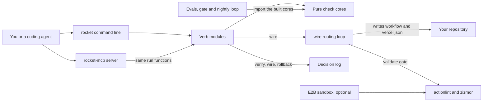

# How Rocket works

Rocket is a release-engineering helper for developers and coding agents.
Release engineering is the work of building, checking and shipping code to production.
Rocket writes a GitHub Actions workflow for a repository and audits workflows for known attack patterns.
It checks that a deploy shipped the expected commit, and it plans rollbacks, preview clean-ups and safe schema changes.
Its rule is "verify, don't trust the checkmark": a green CI badge alone never counts as proof.
Its core checks run locally, with no model and no key.

## The parts



The command line is [tools/rocket/src/cli.ts](../tools/rocket/src/cli.ts), compiled to [tools/rocket/dist/cli.js](../tools/rocket/dist/cli.js), which the repository commits.
It fills missing keys from a local `.env` file, then registers nine commands with commander.
Each command calls a `run` function in [tools/rocket/src/commands/](../tools/rocket/src/commands/) that returns one result shape from [tools/rocket/src/output.ts](../tools/rocket/src/output.ts).
The MCP server in [tools/rocket/src/mcp-server.ts](../tools/rocket/src/mcp-server.ts) wraps seven of those functions as tools over standard input and output.
MCP, the Model Context Protocol, lets an agent call tools by name.
[tools/rocket/src/sandbox/e2b-runner.ts](../tools/rocket/src/sandbox/e2b-runner.ts) can run the actionlint check inside an E2B sandbox, a short-lived cloud machine.

The checks are pure functions in [tools/rocket/src/core/](../tools/rocket/src/core/).
They lint action references, compare commit SHAs, check timestamps, classify schema changes and find the pwn-request pattern.
A pwn request is a workflow that checks out pull request code while it holds repository secrets.
The `wire` loop in [tools/rocket/src/routing.ts](../tools/rocket/src/routing.ts) writes a workflow and stops unless actionlint passes.
`verify`, `wire` and `rollback` log each decision to `logs/runs.jsonl` through [tools/rocket/src/log-decision.ts](../tools/rocket/src/log-decision.ts).
The evals in [eval/](../eval/) import the built cores, and [workflows/rsi.workflow.js](../workflows/rsi.workflow.js) reruns them every night.

## What happens when you run it

The main flow wires CI into a repository: `rocket wire --target ./my-app`.

1. [tools/rocket/src/cli.ts](../tools/rocket/src/cli.ts) loads missing keys through [tools/rocket/src/load-env.ts](../tools/rocket/src/load-env.ts) and parses the flags.
2. It calls `runWire` in [tools/rocket/src/commands/wire.ts](../tools/rocket/src/commands/wire.ts). The default lane is `vercel` and the default strategy is `bluegreen`.
3. With `--dry-run`, `wirePlan` in [tools/rocket/src/routing.ts](../tools/rocket/src/routing.ts) returns the five ordered steps and writes nothing.
4. Otherwise `runWireLoop` checks that the target is a folder. A missing folder returns a clean error.
5. Detect: the lockfile picks pnpm, yarn or npm. A Next.js config file or a `next` dependency marks a Next.js app.
6. Generate: Rocket builds a workflow with build, preview and production jobs, plus a `vercel.json` deploy config.
7. It writes `.github/workflows/deploy.yml` and `vercel.json` to temporary files and renames them, so an interrupted run leaves no half-written file.
8. Validate: it runs `actionlint` on the new workflow. If actionlint is missing or reports problems, the loop stops and says nothing was committed.
9. Commit and verify come back as ready steps with their commands. Rocket does not run `git commit` or deploy anything itself.
10. `logDecision` records GO or NO-GO in `logs/runs.jsonl`, and `emit` prints text, or JSON with `--json`.

In CI, [.github/workflows/acceptance.yml](../.github/workflows/acceptance.yml) runs this flow on [fixtures/sample-next-app/](../fixtures/sample-next-app/) and fails on any actionlint problem.

## Extending it

- **A command.** Add a `run` function that returns a `CommandResult` in [tools/rocket/src/commands/](../tools/rocket/src/commands/). Register it in [tools/rocket/src/cli.ts](../tools/rocket/src/cli.ts).
- **An MCP tool.** Add an entry in [tools/rocket/src/mcp-server.ts](../tools/rocket/src/mcp-server.ts) that calls the same `run` function. Add its name to `EXPECTED_TOOLS` in [tools/rocket/test/mcp-contract.test.ts](../tools/rocket/test/mcp-contract.test.ts).
- **A check.** Add a pure function to [tools/rocket/src/core/](../tools/rocket/src/core/) and cover it in [tools/rocket/test/core.test.ts](../tools/rocket/test/core.test.ts).
- **A skill.** Create `skills/<name>/SKILL.md` with `name` and `description` front matter, like [skills/deploy-verify/SKILL.md](../skills/deploy-verify/SKILL.md).
- **An eval.** Add a flat YAML file to [eval/golden/](../eval/golden/), like [eval/golden/g1-non-sha-action-ref.yml](../eval/golden/g1-non-sha-action-ref.yml). It names a level, a tier, a command, its input inline, and the expected results.

Rebuild `tools/rocket/dist/` after any source change, because the evals and the bin entries load the built files.
Run these before you push:

```bash
cd tools/rocket && npm install && npm run build && npm test && cd ../..
npm run eval
npm run eval:nightly
npm run dsip:check
npm run test:cockpit
```

## Questions

**Does it need an API key or cost money?**
No key is needed for the nine commands, the MCP server or the evals.
The `wire` validate gate needs `actionlint` on your PATH. `zizmor` is optional.
The E2B runner uses `E2B_API_KEY` when present, on your own E2B account.
Without a key it runs the same actionlint check locally and labels the result `local-fallback`.

**Does any data leave the machine?**
The command line and the MCP server make no web requests.
With `E2B_API_KEY`, the E2B runner copies the workflow file into an E2B sandbox and installs actionlint there.
The nightly loop calls `gh repo view` on pinned action repositories when the GitHub CLI is installed.
The cockpit in [web/api.js](../web/api.js) listens on 127.0.0.1 only and never changes files.

**How does it improve itself?**
[dsip.json](../dsip.json) declares the `agent` level, with a nightly loop and no self-grading.
[.github/workflows/rsi.yml](../.github/workflows/rsi.yml) runs [workflows/rsi.workflow.js](../workflows/rsi.workflow.js) every day at 07:00 UTC.
The loop checks pinned action repositories for drift and reruns the golden tasks against [eval/baseline.json](../eval/baseline.json).
It also runs actionlint on Rocket's own workflows.
It writes a proposal under [proposals/](../proposals/), and CI uploads it for a person to review.
The loop never commits. The model half that would rewrite notes is not built yet.

**How do I run its tests or evals?**
`npm test` inside `tools/rocket` compiles the code and runs the Node test files.
`npm run eval` runs the golden tasks that block CI, and `npm run eval:nightly` adds four nightly ones.
`npm run eval:all` adds the model-judged task G15, which is reported as deferred because no judge is built.
`rocket eval-gate` compares scores with [eval/baseline.json](../eval/baseline.json) against a floor of 0.8 and a Welch's t-test, a check for a real drop.

**What does it not do?**
It does not commit, push or deploy.
`verify` compares SHAs from a `deployed.json` record or from flags. It does not fetch a live URL yet.
`rollback` and `preview reap` print plans. They do not call Vercel, Fly or Neon.
`migrate-plan` never touches a database.
Every lane writes the same Vercel-shaped workflow and `vercel.json` today.
The generated workflow pins each action to a full commit SHA, with its tag in a comment, so `rocket audit` passes on it.
Those SHAs are fixed in the source, so they do not follow new releases of the actions.
